# GameQueue: a guided tour

This is the easy-reading version of how GameQueue works. It starts with the big picture, then walks through each subsystem one at a time: what it's for, how the pieces fit, and where the code lives.

For the exhaustive reference (every route, column and edge case), see `ARCHITECTURE.md`. For product decisions and working rules, see `CLAUDE.md`. This document leaves details out on purpose, so you can build a mental model first.

**Contents**

1. [The big picture](#1-the-big-picture)
2. [How the repo is organized](#2-how-the-repo-is-organized)
3. [The shared package: the contract](#3-the-shared-package-the-contract)
4. [The life of a request](#4-the-life-of-a-request)
5. [The database](#5-the-database)
6. [Accounts, login and sessions](#6-accounts-login-and-sessions)
7. [Talking to IGDB](#7-talking-to-igdb)
8. [The collection: games and their status](#8-the-collection-games-and-their-status)
9. [Slots: what you're playing right now](#9-slots-what-youre-playing-right-now)
10. [Organizing games: lists, queue, smart lists, wishlist](#10-organizing-games-lists-queue-smart-lists-wishlist)
11. [Random pick](#11-random-pick)
12. [Stats and Save File](#12-stats-and-save-file)
13. [Public profile and share cards](#13-public-profile-and-share-cards)
14. [Export and import](#14-export-and-import)
15. [The account page](#15-the-account-page)
16. [Admin and monitoring](#16-admin-and-monitoring)
17. [The web app](#17-the-web-app)
18. [Background work](#18-background-work)
19. [Deployment and operations](#19-deployment-and-operations)
20. [Testing](#20-testing)
21. [Glossary](#21-glossary)
22. [Where do I look when…](#22-where-do-i-look-when)

---

## 1. The big picture

GameQueue is a personal video game collection manager that also helps answer "what should I play next?". You add games you own, track your playthroughs, put games in "slots" for what you're playing now, plan an "up next" queue, and get stats and a yearly recap.

Technically it's a classic three-part web app, plus one outside service:

- **A web app** (React) that runs in the browser.
- **An API server** (Node + Hono) that holds all the rules.
- **A database** (one SQLite file) that stores everything.
- **IGDB** (the Internet Game Database, run by Twitch) supplies game information: names, covers, release dates, platforms, genres, how long a game takes to beat.

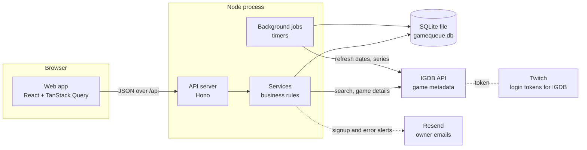

A few principles explain most of the design:

- **The server is the source of truth.** The browser never talks to IGDB and never decides whether something is allowed. It asks the server, and the server checks.
- **One process, one file.** In production, a single Node process serves both the API and the built web app, and all data lives in one SQLite file. That keeps hosting and backups simple.
- **Game info is shared, your data is private.** IGDB information about a game is cached once and shared by all users. Everything about _your_ relationship with a game (that you own it, your rating, your notes) is stored per user.
- **Rules live in one place.** Pure logic (status rules, random pick, stats math) lives in a shared package that both the server and the browser can use, so they never disagree.

---

## 2. How the repo is organized

It's an npm "workspaces" monorepo: one repository holding three packages that depend on each other.

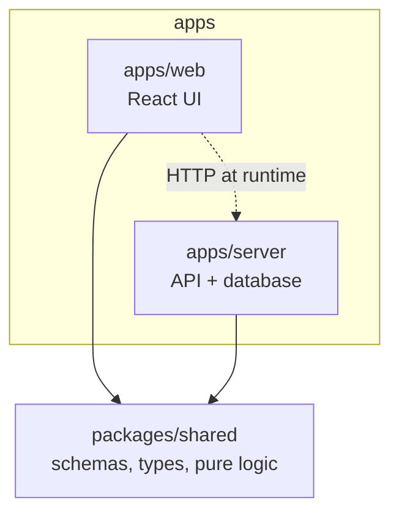

| Folder                | What's in it                                                                                   |
| --------------------- | ---------------------------------------------------------------------------------------------- |
| `apps/web`            | The React app: pages (`src/routes/`), reusable UI (`src/components/`), data hooks (`src/api/`) |
| `apps/server`         | The API: HTTP routes (`src/routes/`), business logic (`src/services/`), database, IGDB client  |
| `packages/shared`     | Things both sides need: input validation schemas, response types, and pure functions           |
| `apps/server/drizzle` | Database migrations (SQL files, generated, committed)                                          |
| `apps/server/test`    | Server test suites                                                                             |
| `scripts/`            | `backup.sh` and `update.sh`, which run on the production machine                               |

Inside the server, the folders are layered. Each layer only calls the ones below it:

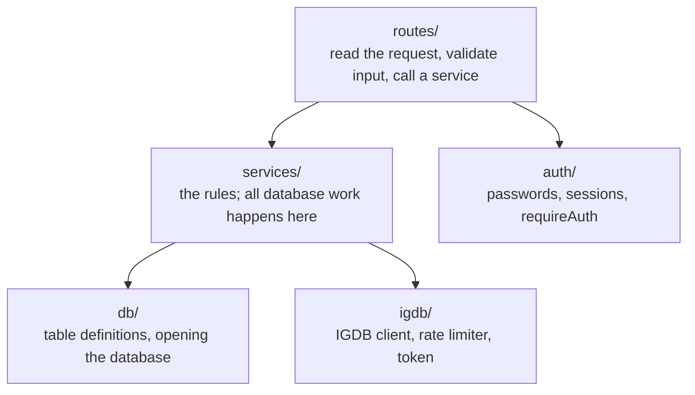

The day-to-day commands:

| Command                                          | What it does                                                          |
| ------------------------------------------------ | --------------------------------------------------------------------- |
| `npm run dev`                                    | Server on :3000 and web on :5173 (Vite forwards `/api` to the server) |
| `npm test`                                       | All test suites                                                       |
| `npm run typecheck`                              | TypeScript check across all packages                                  |
| `npm run format`                                 | Prettier                                                              |
| `npm run db:generate`                            | Create a migration after editing the schema                           |
| `npm run build && NODE_ENV=production npm start` | Production mode: one process serves the API and the built web app     |

---

## 3. The shared package: the contract

`packages/shared` is the agreement between the browser and the server. It has no build step: both apps import its TypeScript directly.

It holds three kinds of things:

1. **Input schemas** (Zod). For example `addEntrySchema` describes what "add a game" must look like. The server uses it to reject bad input; the web app uses the same types to build its requests.
2. **Response types** (DTOs, "data transfer objects"). For example `EntryDto` is the shape of a game in your collection as the API returns it. When the server changes a DTO, the web app fails to typecheck until it's updated, which catches mismatches early.
3. **Pure logic.** Functions with no database or network access, so they're easy to test and can run on either side:

| File              | What it decides                                                  |
| ----------------- | ---------------------------------------------------------------- |
| `status.ts`       | Which status changes are allowed (unplayed → playing, and so on) |
| `pick.ts`         | The random "what should I play" choice                           |
| `smart-lists.ts`  | Whether a game matches a smart list's rules                      |
| `stats.ts`        | All stats arithmetic                                             |
| `recap.ts`        | The year-in-review numbers and your "archetype"                  |
| `release.ts`      | Release date labels like "Q4 2027" or "in 3 weeks"               |
| `csv.ts`          | Writing spreadsheet-safe CSV                                     |
| `avatar.ts`       | The generated identicon picture from a username                  |
| `avatar-icons.ts` | Preset avatar icons (game-icons.net) and background colours      |
| `export.ts`       | The export file format                                           |

A good rule of thumb: if a piece of logic doesn't need the database, it probably belongs here, with a unit test next to it.

---

## 4. The life of a request

Let's follow one click all the way through: putting a game into a slot.

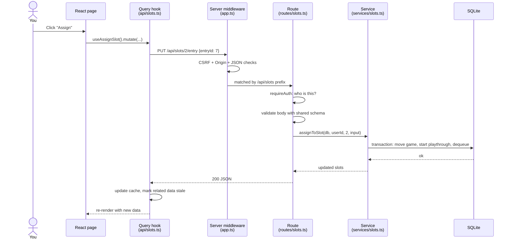

Step by step:

1. **The page calls a hook.** Pages never call `fetch` directly. Each area has hooks in `apps/web/src/api/` (for example `useSlots`, `useAssignSlot`). They all go through one small `api()` function in `client.ts` that sends JSON and turns error responses into exceptions.
2. **Safety checks.** Every `/api` request passes through middleware in `app.ts`. Changes (POST/PUT/PATCH/DELETE) must come from an allowed website origin and send JSON. This blocks cross-site request forgery: another website can't trick your browser into changing your data.
3. **Routing.** The URL prefix picks a router (`/api/slots` → `routes/slots.ts`).
4. **Authentication.** `requireAuth` reads the session cookie and works out which user is asking. No valid session means 401.
5. **Validation.** The route checks the body against a shared Zod schema. Bad input is a 400 with details about which field was wrong.
6. **The service does the work.** Routes are thin; the rules live in services. Every query is filtered by the user's id, so one user can never touch another's data.
7. **Errors.** A service that needs to say "no" throws an `HttpError` (for example 404 not found, 409 conflict). A central handler turns it into `{ error: "..." }` JSON. Anything unexpected becomes a 500 and is recorded in the error log (section 16).
8. **The browser refreshes.** After a change, the hook tells TanStack Query which cached data is now stale, and any page showing it refetches.

**Transactions.** When one action touches several tables, the service wraps it in a database transaction so it either fully happens or doesn't happen at all. Services can call other services inside a transaction (assigning to a slot reuses "start playthrough"), and a thrown error rolls the whole thing back.

---

## 5. The database

Everything is in one SQLite file. Tables are defined in TypeScript (`apps/server/src/db/schema.ts`) with Drizzle, an ORM. When the schema changes, `npm run db:generate` writes a SQL migration file, and migrations run automatically every time the server starts.

The tables split cleanly into two halves.

### The shared game cache

Information that comes from IGDB. It has no owner: if two users own the same game, it's stored once. Rows are keyed by IGDB's own ids.

- `games`: name, summary, cover, release date, IGDB score, time to beat, screenshots.
- `platforms`, `genres`, `themes`, plus join tables linking them to games.
- `series`, `game_series`, `series_members`: which games belong to which series.

### Per-user data

Everything that belongs to a user carries a `user_id` (directly, or through an entry). When a user is deleted, the database cascades the delete through all of it automatically.

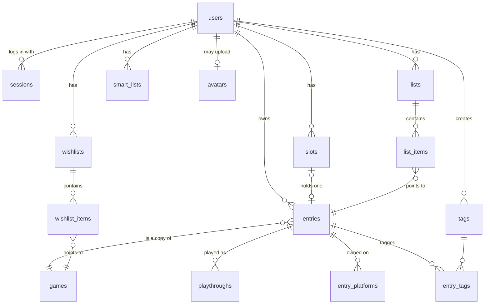

The key idea is the **entry**: one row meaning "this user owns this game". Your status, rating and notes live on the entry (a game can have many notes, each private or shared on your profile). Lists, slots and playthroughs all hang off entries.

The **wishlist is the exception**: wishlist items point straight at the shared `games` table, not at an entry, because you don't own those games yet. That way nothing that works on your collection (backlog, stats, pick, slots) has to worry about unowned games.

Things that are **not stored** but computed when needed:

- **The backlog**: every entry whose status is `unplayed`.
- **Smart lists**: only the rules are saved; the matching games are worked out on every read.
- **Stats and recap**: calculated fresh from entries and playthroughs.

There are also a handful of **operational tables** for the admin area: `error_events`, `igdb_daily`, `server_runs` and `settings` (section 16).

---

## 6. Accounts, login and sessions

Logging in uses a username and password. The password is hashed with argon2id (a slow, memory-hard hash designed for passwords), so the database never holds it in readable form.

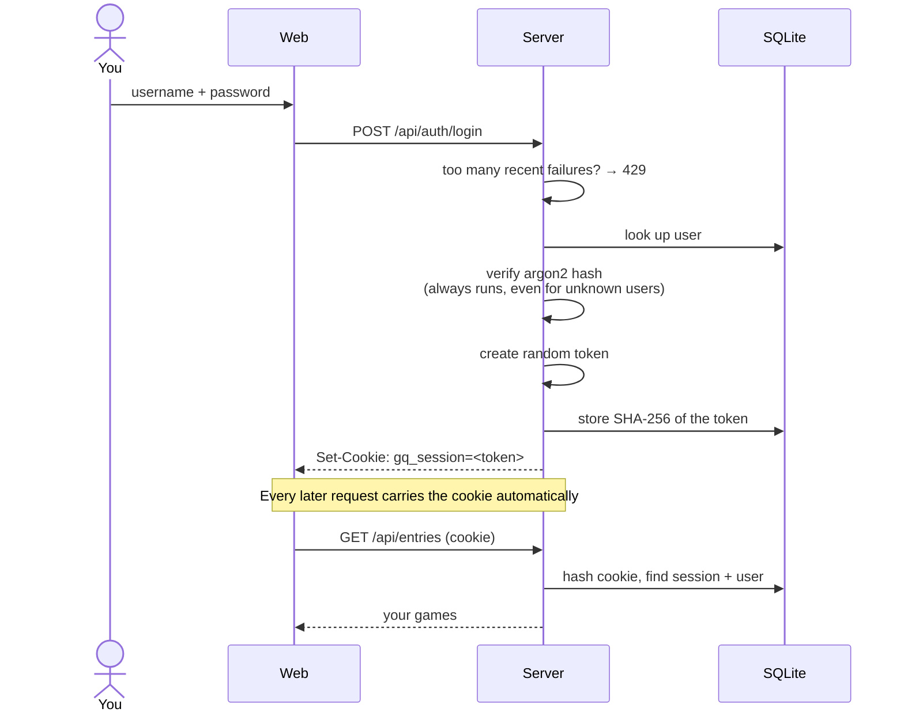

The important ideas:

- **The cookie holds a random token; the database only holds its hash.** If someone stole a copy of the database, they still couldn't use it to log in as anyone.
- **The cookie is `httpOnly`**, so JavaScript in the page can't read it, and `SameSite=Lax`, which helps against cross-site attacks.
- **Sessions last 30 days and slide**: if you keep using the app, the expiry keeps moving forward.
- **Login is rate limited** (in memory): 5 failures per account per 15 minutes, 30 per IP address.
- **Errors are vague on purpose.** A wrong username and a wrong password give the same message and take the same time, so nobody can probe which usernames exist.

**Roles.** Every user is a `gamer` or an `admin`. `requireAdmin` guards the admin API. The web app hides admin links from gamers, but that's only cosmetic; the server is what enforces it.

**Signups** can be switched off (by environment variable, or by an admin at runtime), which turns registration into a 403.

Code: `apps/server/src/auth/` and `routes/auth.ts`.

---

## 7. Talking to IGDB

IGDB is where all game information comes from. Only the server talks to it; the credentials never reach the browser.

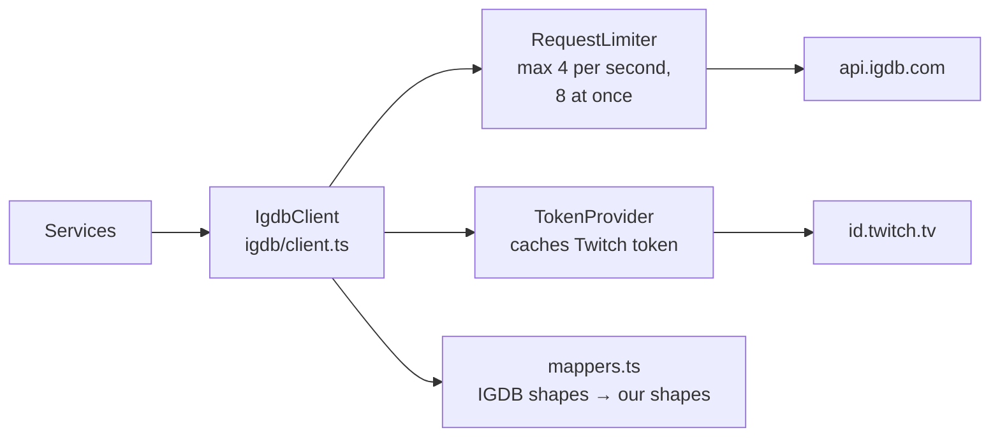

The pieces:

- **Token.** IGDB needs a Twitch access token. `token.ts` gets one, caches it, and renews it an hour before it expires. If IGDB says the token is bad (401), it fetches a new one and retries once.
- **Rate limiting.** IGDB allows 4 requests per second and 8 in flight. Every call waits in the `RequestLimiter` queue to stay under that. If IGDB still answers "too many requests" (429), the call is retried up to 3 times.
- **Mapping.** IGDB's raw responses are converted into our own types in `mappers.ts`. This is also where add-ons (DLC, mods, packs) are filtered out of search results.
- **Caching.** Search results are cached for 5 minutes. Game details are saved in the `games` table and almost never fetched again.

**Adding a game to your collection** shows how the cache works:

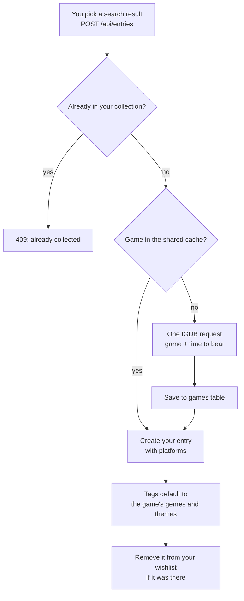

**Without credentials**, the app still runs, but search and add-game return 503.

**The exceptions to "never fetch again"** are a few background refreshes, covered in section 18: release dates for unreleased wishlisted games, series membership, and screenshots for older games.

Code: `apps/server/src/igdb/`, `services/games.ts`, `routes/igdb.ts`.

---

## 8. The collection: games and their status

Each game you own has a **status**, and a history of **playthroughs** (one per time you played it).

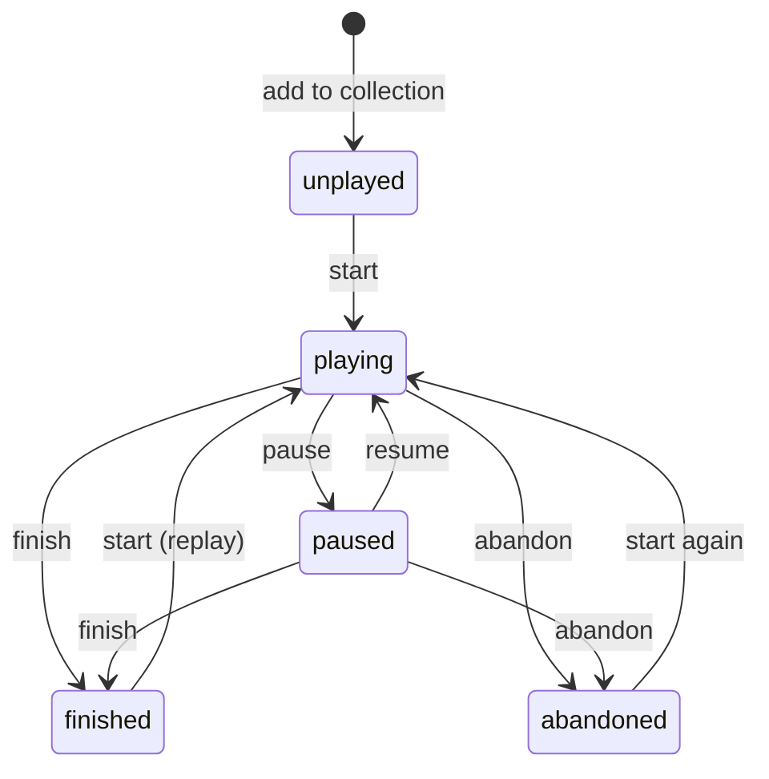

How status and playthroughs relate:

- **Start** opens a new playthrough (with a start date and platform) and sets status to `playing`.
- **Pause/resume** only change the status; the playthrough stays open.
- **Finish/abandon** close the playthrough with an end date and outcome.
- A game has **at most one open playthrough** at a time; the database enforces it with a unique index.
- You can **log a past playthrough** for a game finished years ago. Dates may be unknown, and stats skip unknown dates.
- If you edit or delete history, `syncStatus` recalculates the status from what's left (for example, deleting the only playthrough makes the game `unplayed` again).

The allowed moves are defined once in `packages/shared/src/status.ts`. The server enforces them; the web app uses the same file to decide which buttons to show.

**Ratings** are 1 to 5 stars on the entry. You can rate a playthrough when finishing it, and that fills in the game's rating only if it was empty.

**Browsing the collection** (`/collection` and `/backlog`) uses faceted filters: status, platform, genre, tag and series. Within one facet, any value matches ("PS5 or Switch"); across facets, all must match ("PS5 and RPG"). The counts next to each option show how many games you'd get if you picked it.

Code: `services/entries.ts` (collection), `services/playthroughs.ts` (status changes).

---

## 9. Slots: what you're playing right now

Slots are named "currently playing" spaces, like "Main", "Secondary" and "Palate cleanser" (the defaults every new user gets; up to 10). Each holds at most one game. They show on the home page.

The rules keep slots and status from ever disagreeing:

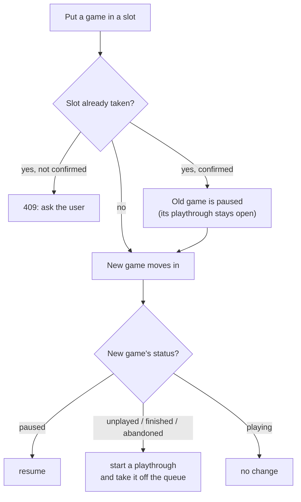

And going the other way:

- **Finishing or abandoning** a game empties its slot.
- **Clearing or deleting a slot** pauses its game (it never just drops it).
- **Deleting a game** empties its slot automatically (the database sets it to null).
- **Pausing** a game keeps it in its slot.

So a game in a slot is always `playing` or `paused`. The whole assignment runs in one transaction.

Code: `services/slots.ts`, `components/SlotBay.tsx`.

---

## 10. Organizing games: lists, queue, smart lists, wishlist

There are four ways to group games. They look similar on screen but work differently underneath.

| Feature        | What it holds                  | Order                 | Stored as                             |
| -------------- | ------------------------------ | --------------------- | ------------------------------------- |
| **List**       | Games you own                  | Manual (drag to sort) | `lists` + `list_items`                |
| **Queue**      | Games you own                  | Manual                | A special `lists` row, `kind = queue` |
| **Smart list** | Games you own that match rules | Sorted by a field     | Only the rules, in `smart_lists`      |
| **Wishlist**   | Games you _don't_ own          | Manual                | `wishlists` + `wishlist_items`        |

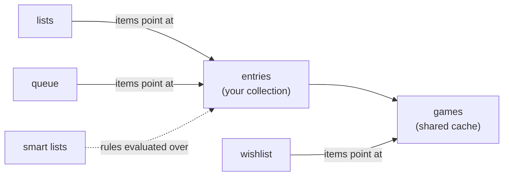

### Lists

Plain named lists with an optional description. Items are addressed by the entry id, and adding the same game twice does nothing.

### The queue

Your single "up next" plan. It's stored as a list with a special `kind`, so it reuses all the list code (ordering, export, random pick), but it can't be renamed or deleted, and it doesn't appear among your regular lists. It's created the first time you need it.

**Starting a game takes it off the queue.** Nothing ever fills a slot automatically from the queue; that's always your choice.

### Smart lists

Saved filters such as "unplayed, under 10 hours, IGDB score at least 80". Rules are combined with AND. Because only the rules are stored, the list is always up to date: the server loads your collection and checks each game against the rules on every read. The editor's live preview runs the very same function in the browser.

Five ready-made presets (Quick wins, Hidden gems, Long-neglected, Gathering dust, Replay candidates) can be added with one click and then edited like any other smart list.

### Wishlist

Games you want but don't own, in a manual order (top = most wanted), with an optional target platform and a private note.

A game can't be both owned and wishlisted. Wishlisting an owned game is refused, and adding a game to your collection removes it from your wishlist. Unreleased wishlisted games get a release badge ("in 3 weeks", "Q4 2027"), and the home page shows ones coming out in the next two weeks.

### Reordering and paging

Long lists load a page at a time ("Load more"). Dragging an item sends a single "move this item to position N" request (`services/order.ts`), so reordering works even when only the first page is loaded.

Code: `services/lists.ts`, `services/smart-lists.ts`, `services/wishlist.ts`, `services/order.ts`.

---

## 11. Random pick

"I can't decide what to play" mode. There are two flavours on the `/pick` page.

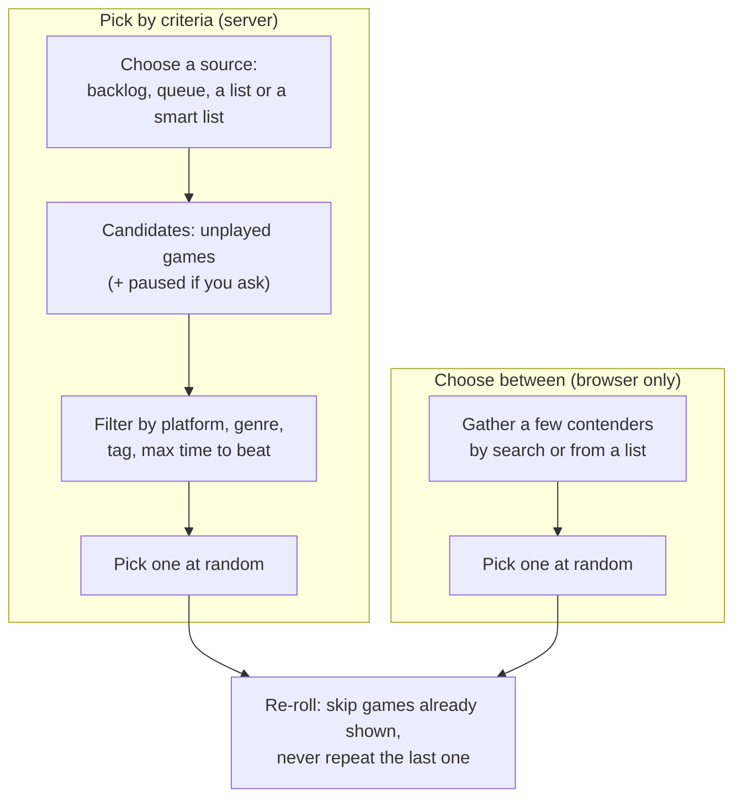

Both use `pickRandom` from `packages/shared/src/pick.ts`. It's a pure function that takes its random number generator as a parameter, which makes it easy to test with a predictable "random" sequence.

---

## 12. Stats and Save File

Both are computed fresh from your entries and playthroughs; nothing is stored.

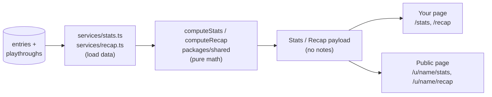

- **Stats**: totals, games finished per year and over the last 12 months, top platforms/genres/tags, rating spread, top rated, and total play time (the hours you enter when finishing a game, added up; nothing is actually timed).
- **Save File** (the year in review, "Wrapped" for games): what you finished, started, added and abandoned in a year, your busiest month, longest and shortest games, and a playful archetype like "marathoner" or "collector".

The split between loading (server) and arithmetic (shared, pure) is a pattern you'll see repeatedly. It makes the math easy to test without a database. The payload never contains notes, so the same response can be shown publicly.

---

## 13. Public profile and share cards

Every user has a public profile at `/u/:username`, viewable without logging in. It shows what you're playing, counts per status, your lists and smart lists, and links to sub-pages (your backlog, finished games by year, wishlist, stats, recap). It never shows your email, and only shows notes you marked public (on a game's page).

Public endpoints live under `/api/profiles` and don't require a session. They return reduced "public" versions of the data (`PublicEntryDto` instead of `EntryDto`).

### Share cards (link previews)

When you paste a profile, year-in-review, grid or tier list link into Discord or Slack, their crawler doesn't run JavaScript, so it can't see the React page. The server handles that:

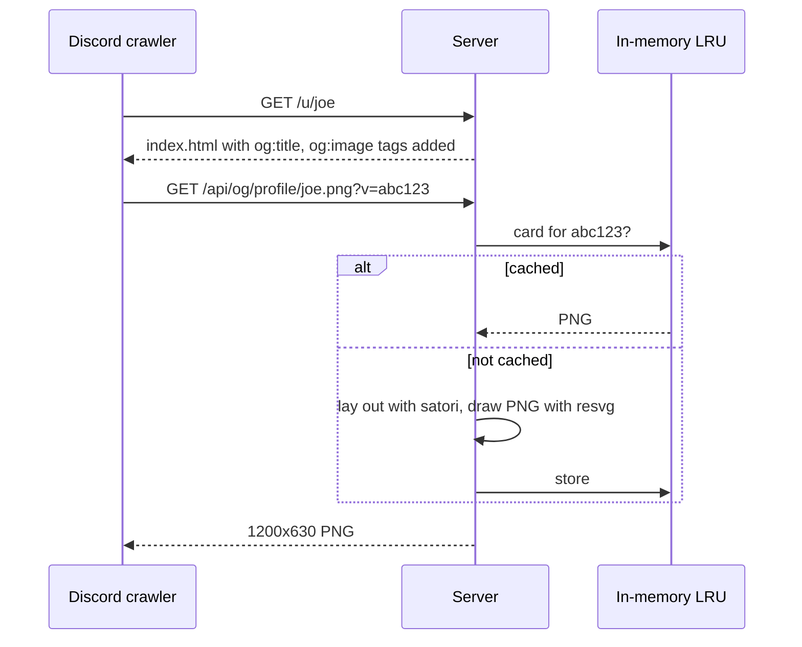

The `?v=` value is a hash of what's on the card, so when your profile changes, the URL changes and the crawler fetches a fresh image. Cards are only kept in memory (32 of them), never on disk.

Code: `services/profile.ts`, `routes/profile.ts`, `apps/server/src/og/`, `web.ts`.

---

## 14. Export and import

You can download your whole collection as one JSON file and import it again, here or on another server.

- **The file is self-contained.** Each game carries a snapshot of its IGDB metadata, so importing never needs to call IGDB.
- **The file is versioned** (`format: gamequeue-export`, `version: 1`). Changing the format means bumping the version and keeping a reader for older files.
- **Import merges; it never replaces.** Games match by IGDB id, lists and slots by name. Your existing values win, empty fields get filled in, and nothing is ever removed. Importing the same file twice changes nothing.
- **Import is a dry run by default.** The server performs the real merge inside a transaction, records what happened, then rolls it back. You see an exact report first, and only `?commit=true` keeps the changes.

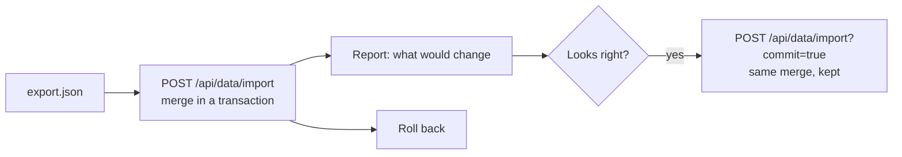

There's also a **CSV export** (whole collection, a list, the queue or a smart list) for spreadsheets. It's one-way: CSV can't be imported.

Code: `services/export.ts`, `services/import.ts`, `packages/shared/src/export.ts`, `csv.ts`.

---

## 15. The account page

`/account` collects the personal settings:

- **Avatar.** By default, a generated identicon based on your username (computed in the browser; nothing stored). The account page shows your current picture and a "Change picture" button that opens a dialog with all the options. You can pick one of about 50 preset game icons on a colour of your choice (stored as just a name and a colour number), or upload a picture instead. Choosing one replaces the other. The upload works like this: the browser crops and shrinks it to a small square image before sending it, and the server checks its type and size and stores it in the `avatars` table.
- **Real name.** Optional first and last name. Private unless you tick "show on profile". The first name is used for greetings on the home page.
- **Gaming accounts.** Steam, Xbox, PlayStation and Discord names, shown as links on your public profile once filled in.
- **Password change.** Needs your current password, and signs out your other sessions.
- **Delete account.** Needs your password and a confirmation. The database cascades the delete through every table that belongs to you. (Anything new keyed by `user_id` must cascade too, or this breaks.)

The icons come from game-icons.net and are credited on the `/credits` page (linked from every footer).

Code: `routes/account.ts`, `routes/avatar.ts`, `services/users.ts`, `services/avatars.ts`.

---

## 16. Admin and monitoring

Admins get an `/admin` area. It's mostly about keeping an eye on the running server.

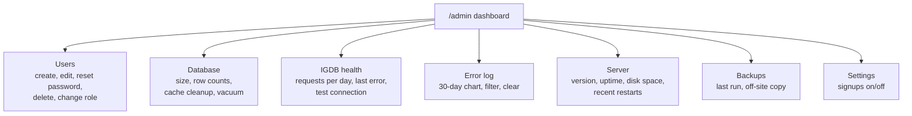

How the monitoring pieces fit together:

- **Error log.** `reportError()` is called from a few central places: the server's error handler (unexpected 500s), the IGDB client (failures and rate limits), background jobs, and crash handlers. Each call writes a row to `error_events`. If one kind of error happens 5 times in 10 minutes, the owner gets an email (through Resend), at most one per hour per kind.
- **Server runs.** Each start writes a row to `server_runs` and updates a heartbeat every minute. A normal stop is recorded as `clean`, a crash as `crash`. If the server died without warning (power loss, out of memory), the next start notices the run was never closed and records it as `unclean`.
- **IGDB history.** Every IGDB request is counted per day in `igdb_daily`, so you can see when you were rate limited.
- **Backups.** The app can't run backups itself. `scripts/backup.sh` (on the host) writes a small status file after each run, and the admin page reads and displays it.
- **Safety guards.** An admin can't delete themselves from the admin pages, and the last admin can't be demoted or deleted, so you can't lock yourself out.

Code: `routes/admin.ts` and the `services/` files named after each panel (`error-log.ts`, `server-runs.ts`, `igdb-history.ts`, `backup-status.ts`, `database-stats.ts`, `maintenance.ts`, `server-info.ts`, `settings.ts`, `admin-users.ts`).

---

## 17. The web app

The web app is a single-page app: the browser loads it once, then switches pages without full reloads.

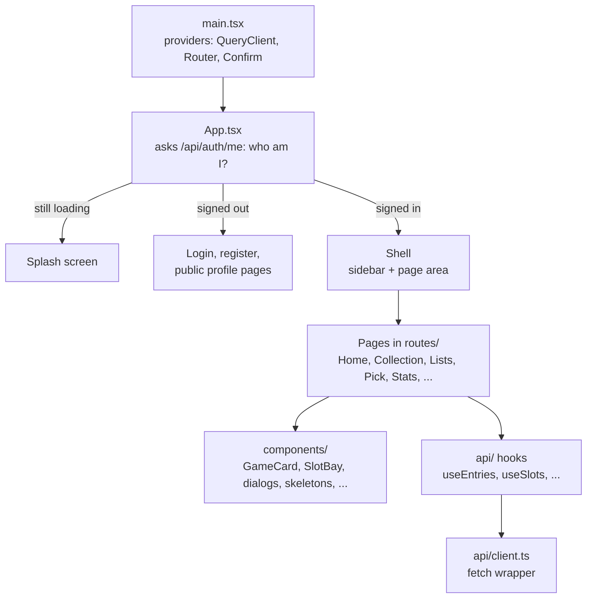

### Data fetching with TanStack Query

TanStack Query is a cache of server data in the browser. Two kinds of hooks:

- **Queries** read data (`useSlots()`, `useEntries(filters)`). Each has a key like `['slots']`. Data is cached by key, so moving between pages is instant, and a query is refetched when it's marked stale.
- **Mutations** change data (`useAssignSlot()`). When one succeeds, it invalidates the keys it might have affected, and every page showing that data refetches.

Long lists use an "infinite query" with a "Load more" button that fetches the next page.

### Conventions worth knowing

- **Loading skeletons, always.** Every page shows shimmering placeholder shapes while its data loads, never a blank page or a bare "Loading…".
- **Confirmations** use `useConfirm()` (a promise-based dialog), never `window.confirm`.
- **Dialogs** use the native `<dialog>` element through `useModalDialog`.
- **Page titles** are set with `usePageTitle()`.
- **Styling**: design tokens (colours, spacing, light and dark themes) in `styles/tokens.css`, everything else in `styles/app.css`. Icons from Lucide.
- **Layout choice** (cover grid or rows) is remembered per browser in `localStorage`.

### Development vs production

In development, Vite serves the web app on port 5173 and forwards `/api` calls to the server on 3000. In production, the web app is built into static files and the API server serves them itself, falling back to `index.html` for any page URL so the React router can take over.

---

## 18. Background work

A few things happen on timers, not in response to a click. All run inside the same Node process.

| What                                       | When                                                | Why                                                       |
| ------------------------------------------ | --------------------------------------------------- | --------------------------------------------------------- |
| Purge expired sessions                     | Startup, then every 6 hours                         | Keep the `sessions` table clean                           |
| Prune error log, IGDB history, server runs | Startup, then every 6 hours                         | Keep only 30 / 90 days                                    |
| Heartbeat                                  | Every minute                                        | Detect unclean shutdowns on the next start                |
| Series backfill                            | Startup and after an import                         | Fill in series for games cached before series were stored |
| Release date refresh                       | When you open your wishlist, at most daily per game | Unreleased games' dates change                            |
| Screenshots                                | When you open a game that never had them fetched    | Older cache rows predate screenshots                      |

Background jobs that fail are logged to the error log and simply retried next time. They never break the request that triggered them.

All of this is wired up in `apps/server/src/index.ts`, which is the best file to read to see how the server starts.

---

## 19. Deployment and operations

GameQueue runs in Docker on a Raspberry Pi at home, reachable on the internet through a Cloudflare Tunnel. (A move to a DigitalOcean Droplet is planned; see `CLOUD_MIGRATION.md`.)

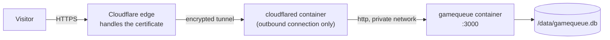

- **No open ports.** The Pi makes an outbound connection to Cloudflare; nothing on the home network is exposed.
- **Deploys happen on push.** GitHub Actions checks formatting, types and tests on every push. On `main`, it builds an arm64 Docker image and publishes it.
- **Updates are pulled.** A cron job on the Pi (`scripts/update.sh`) notices a new image, backs up the database, restarts the app and rolls back if it fails to come up.
- **Backups** (`scripts/backup.sh`) take a safe snapshot of the live database nightly, keep 14 days, and optionally copy off-site. An external service (healthchecks.io) alerts if backups stop running.

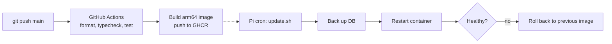

Full procedure, configuration variables and troubleshooting: `DEPLOYMENT.md`.

---

## 20. Testing

Tests run with Vitest.

- **Server tests** (`apps/server/test/`) build a complete app with `makeApp()`: a fresh in-memory SQLite database, the real migrations, and a fake IGDB client. They send real HTTP requests with `app.request()` and check the responses. This tests routes, services and the database together, without a network.
- **Shared tests** (`packages/shared/src/*.test.ts`) unit-test the pure logic: status rules, pick, smart lists, stats, recap, release labels, CSV.
- **Web tests** are few so far (`lib.test.ts`, `gauge.test.ts`). React components and hooks are not tested yet.

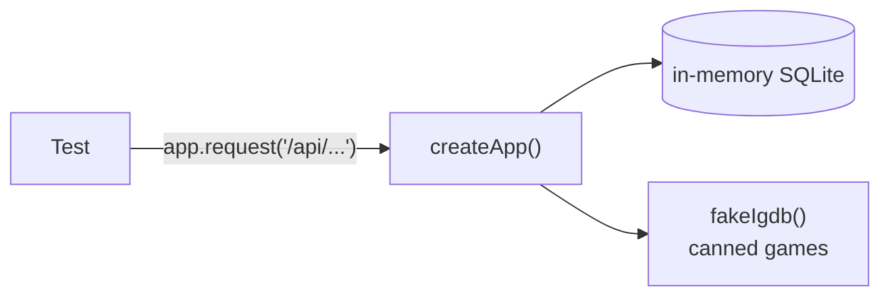

Helpers in `apps/server/test/helpers.ts`: `makeApp`, `register` (create a user and get a session cookie), `fakeIgdb`, `fakeGame`.

---

## 21. Glossary

| Term             | Meaning                                                                                      |
| ---------------- | -------------------------------------------------------------------------------------------- |
| **Entry**        | A game in a user's collection (one row in `entries`). Not the same as a game.                |
| **Game**         | IGDB's information about a title, cached and shared between users.                           |
| **Playthrough**  | One time you played a game, from start to finish (or abandon, or still open).                |
| **Backlog**      | Your games with status `unplayed`. Computed, not stored.                                     |
| **Slot**         | A named "currently playing" space holding one game.                                          |
| **Queue**        | Your ordered "up next" plan. A special list.                                                 |
| **Smart list**   | Saved rules; the games that match are worked out on every read.                              |
| **DTO**          | The shape of data the API sends back (for example `EntryDto`). Defined in `packages/shared`. |
| **Service**      | A server function holding business rules and database access (`apps/server/src/services/`).  |
| **Route**        | A server HTTP handler. Thin: validates input and calls a service.                            |
| **Migration**    | A SQL file that changes the database schema; runs automatically at startup.                  |
| **IGDB**         | The Internet Game Database (Twitch). Source of all game metadata.                            |
| **Time to beat** | IGDB's estimate of how long a game takes to finish.                                          |
| **Share card**   | The preview image shown when a profile or recap link is pasted into chat apps.               |

---

## 22. Where do I look when…

| I want to…                             | Start here                                                                                                 |
| -------------------------------------- | ---------------------------------------------------------------------------------------------------------- |
| See how the server starts              | `apps/server/src/index.ts`                                                                                 |
| See every API prefix                   | `apps/server/src/app.ts`                                                                                   |
| Find the rule behind an API call       | The route in `routes/`, then the service it calls                                                          |
| Change what a status action allows     | `packages/shared/src/status.ts`                                                                            |
| Add a database column                  | `apps/server/src/db/schema.ts`, then `npm run db:generate`                                                 |
| Add a page                             | A component in `apps/web/src/routes/`, a route in `App.tsx`, hooks in `apps/web/src/api/`, plus a skeleton |
| Change how a game is fetched from IGDB | `apps/server/src/igdb/client.ts` and `mappers.ts`                                                          |
| Understand a test failure              | `apps/server/test/<area>.test.ts` and `helpers.ts`                                                         |
| Look up an exact detail                | `ARCHITECTURE.md`                                                                                          |

A typical new feature touches every layer once, in this order:

```mermaid
flowchart LR
    A["Schema<br/>db/schema.ts<br/>+ migration"] --> B["Shared<br/>input schema + DTO"]
    B --> C["Service<br/>the rules"]
    C --> D["Route<br/>validate + call"]
    D --> E["Test<br/>server test"]
    E --> F["Web hook<br/>api/*.ts"]
    F --> G["Page + skeleton<br/>routes/, components/"]
```
